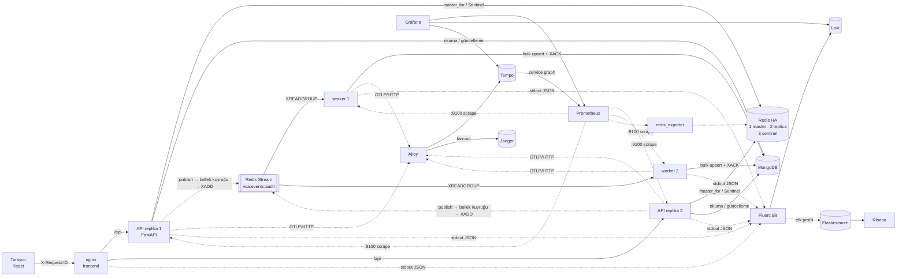

# VEON Best-Practice Örnek Uygulaması

Bu repo, VEON / agentic-core üzerinde çalışan geliştiriciler için **çalışan, ölçülmüş** bir referans uygulamadır.
Küçük bir domain (ürün kataloğu + flash-sale) üzerinden şu konuları uçtan uca gösterir:

| # | Konu | Kısaca | Doküman |
|---|------|--------|---------|
| 1 | **Tracing** | OpenTelemetry → Alloy → **Tempo + Jaeger** (fan-out); HTTP → Redis → Stream → worker → Mongo **tek trace** | [docs/01-tracing.md](docs/01-tracing.md) |
| 2 | **Monitoring** | RED metrikleri (route şablonu ile), iş metrikleri, exemplar (metrik → trace), alarmlar, dashboard-as-code | [docs/02-monitoring.md](docs/02-monitoring.md) |
| 3 | **Logging** | Tek satır JSON, bloklamayan logging, `otel_trace_id` korelasyonu, maskeleme, Loki **ve** EFK | [docs/03-logging.md](docs/03-logging.md) |
| 4 | **Redis HA & eşzamanlılık** | Sentinel (1 master + 2 replica + 3 sentinel), timeout/retry, stampede, Lua, idempotency, kilit, rate-limit | [docs/04-redis-ha-concurrency.md](docs/04-redis-ha-concurrency.md) |
| 5 | **Asenkron log/event yazımı** | Mongo'ya istek içinde yazmak yerine: bellek kuyruğu → Redis Stream → worker → toplu upsert | [docs/05-async-log-pipeline.md](docs/05-async-log-pipeline.md) |
| 6 | **Docker & Helm** | Çok aşamalı, root olmayan, read-only imajlar; HPA/KEDA/PDB/NetworkPolicy/ServiceMonitor içeren chart | [docs/06-kubernetes-helm.md](docs/06-kubernetes-helm.md) |
| 7 | **agentic-core için çıkarımlar** | Mevcut kaynakta tespit edilen riskler ve bu örnekteki karşılıkları | [docs/07-agentic-core-uyum-notlari.md](docs/07-agentic-core-uyum-notlari.md) |

> Ayar isimleri mevcut core ile **aynıdır** (`REDIS_MODE`, `REDIS_SENTINELS`, `REDIS_SENTINEL_MASTER_NAME`,
> `REDIS_PASSWORD`, `REDIS_SENTINEL_PASSWORD`, `OTEL_*`, `APP_VERSION`, `DEPLOYMENT_ENVIRONMENT`) ve
> gözlemlenebilirlik tarafı VEON observability bundle'ı (Alloy, Tempo, Loki, Prometheus, Grafana) ile uyumludur:
> log alanı `otel_trace_id`, Grafana'daki Loki derived-field regex'iyle birebir eşleşir; chart `global.tracing` arayüzünü kullanır.

---

## Mimari



**Akış kuralları**
- Uygulama yalnız **stdout**'a log yazar; logları Fluent Bit/Alloy taşır. Uygulama log backend'ini bilmez.
- Trace'ler OTLP ile **Alloy**'a gider; Alloy aynı trace'leri **Tempo'ya ve Jaeger'a** dağıtır. Uygulama ikisini de
  bilmez — backend eklemek/çıkarmak yalnız collector config'idir. Collector erişilemezse span düşer, istek etkilenmez.
- İş/audit olayları istek içinde Mongo'ya **yazılmaz**; bloklamayan kuyruk → Redis Stream → worker.
- Redis'e **Sentinel** üzerinden bağlanılır; failover'da istemci yeni master'ı kendisi bulur.

---

## Hızlı başlangıç

Gereksinim: Docker (Compose v2), ~4 GB boş RAM (EFK profili için ~6 GB). `make` yoksa komutları Makefile'dan kopyalayın.

```bash
cp .env.example .env      # parolalar ve host portları
make up                   # derler ve başlatır
make smoke                # tüm senaryoları uçtan uca doğrular
make test                 # birim + gerçek Sentinel kümesine karşı entegrasyon testleri
```

| Adres | Ne |
|-------|----|
| http://localhost:8080 | **Lab arayüzü** (tüm senaryolar tek ekranda) |
| http://localhost:3000/d/veon-sample-overview | Grafana dashboard (anonim, yalnız local) |
| http://localhost:3000/explore | Tempo / Loki / Jaeger sorguları (Grafana içinden) |
| http://localhost:16686 | **Jaeger UI** (aynı trace'ler) |
| http://localhost:9090/alerts | Prometheus alarm kuralları |
| http://localhost:8080/api/docs | OpenAPI (Swagger) |
| http://localhost:5601 | Kibana — yalnız `make up-efk` |

> Port çakışması varsa (`port is already allocated`) `.env` içinde `GRAFANA_PORT`, `PROMETHEUS_PORT`,
> `MONGO_PORT` vb. değerlerini değiştirin; arayüzdeki bağlantılar otomatik güncellenir.

`make help` tüm komutları listeler. Sık kullanılanlar:

```bash
make up-efk          # + Elasticsearch/Kibana (loglar hem Loki'ye hem ES'e gider)
make failover        # kontrollü Redis failover (SENTINEL FAILOVER)
make failover-hard   # master container'ını öldür
make failover-freeze # master'ı dondur (ağ bölünmesi benzetimi) → make redis-recover
make worker-stop     # worker'ları durdur → stream'de lag birikir → make worker-start
make helm-lint       # chart lint + template (docker ile)
make clean           # her şeyi ve volume'ları sil
```

---

## Lab senaryoları ve ölçülen sonuçlar

Arayüzdeki her kart bir best-practice'i **karşılaştırmalı** gösterir. Eşzamanlı istekler sunucu tarafındaki
`/api/lab/fanout` ile üretilir (tarayıcının host başına ~6 bağlantı sınırını aşmak ve **iki API replikasına** yük
dağıtmak için); tüm alt istekler aynı trace'e bağlanır. Aşağıdaki değerler bu repo ile local stack'te ölçülmüştür.

| Senaryo | Yapılan | Sonuç (ölçülen) | Gözlem yeri |
|---------|---------|-----------------|-------------|
| Cache stampede | Soğuk cache'e 50 eşzamanlı istek | Korumalı: **1** Mongo okuması (49 `COALESCED`) · korumasız: **50** | X-Cache header, "Cache sonuçları" paneli |
| Flash-sale | Stok 10, 100 eşzamanlı alıcı | Lua (atomik): **10** satış · naif GET→SET: **100** satış (90 fazla satış) | "Eşzamanlılık primitifleri" paneli |
| Idempotency-Key | Aynı anahtarla 10 eşzamanlı + 1 tekrar | Stok yalnız **1** düştü; diğerleri `Idempotent-Replayed: true` | Yanıt header'ı, panel |
| Rate limit | 10 istek / 10 sn, 30 istek, 2 replika | Tam **10** izin, **20** × 429 (replikalar arası ortak sayaç) | `RateLimit-*`, `Retry-After` |
| Dağıtık kilit | İşi 10 kez eşzamanlı tetikle | **1** × 202, **9** × 409; fencing token ile korumalı yazım | Mongo `job_runs` |
| Redis failover (kontrollü) | `SENTINEL FAILOVER` | ~**9 sn** yazma reddi (`NOREPLICAS`), sonra yeni master — bkz. docs/04 | Heartbeat şeridi, "Redis rolleri" paneli |
| Redis failover (sert) | Master container'ını öldür | ~**2 sn** kesinti, otomatik geçiş | aynı |
| Redis failover (donma) | Master'ı dondur (RST yok) | ~**2-3 sn**; 0.5 sn `socket_timeout` sayesinde istek asılı kalmaz | aynı |
| Event pipeline | 2.000 olay | Hepsi Mongo'da, uçtan uca ~**170 ms**; failover sırasında sürekli üretimde **0 kayıp** | Pipeline kartı, "Asenkron pipeline" paneli |
| Worker kesintisi | Worker'lar durdu, 10.000 olay üretildi | API gecikmesi değişmedi; worker'lar dönünce backlog **1,6 sn**'de boşaldı | `events_stream_lag` |
| Uçtan uca trace | Tek rezervasyon | `POST /reserve` → `EVALSHA` → `events.process` (worker) → `events.persist` → `veon_sample.update` **tek trace** | Tempo **ve** Jaeger |

---

## Best-practice haritası (nerede ne var?)

| Konu | Dosya |
|------|-------|
| JSON + bloklamayan logging, trace korelasyonu | [backend/app/observability/logging.py](backend/app/observability/logging.py) |
| Hassas veri maskeleme | [backend/app/observability/redaction.py](backend/app/observability/redaction.py) |
| OTel kurulumu, sampling, `untraced()` | [backend/app/observability/tracing.py](backend/app/observability/tracing.py) |
| Metrikler, exemplar | [backend/app/observability/metrics.py](backend/app/observability/metrics.py) |
| Access log + RED (saf ASGI middleware) | [backend/app/observability/middleware.py](backend/app/observability/middleware.py) |
| Redis HA client fabrikası (timeout/retry/pool/Sentinel) | [backend/app/redis_kit/client.py](backend/app/redis_kit/client.py) |
| Anahtar şeması (prefix, sürüm, hash-tag) | [backend/app/redis_kit/keys.py](backend/app/redis_kit/keys.py) |
| Cache-aside + stampede koruması | [backend/app/redis_kit/cache.py](backend/app/redis_kit/cache.py) |
| Lua script'leri (flash-sale, rate-limit) | [backend/app/redis_kit/scripts.py](backend/app/redis_kit/scripts.py) |
| Idempotency-Key | [backend/app/redis_kit/idempotency.py](backend/app/redis_kit/idempotency.py) |
| Rate limiter | [backend/app/redis_kit/rate_limit.py](backend/app/redis_kit/rate_limit.py) |
| Dağıtık kilit + fencing token | [backend/app/api/lab.py](backend/app/api/lab.py) (`start_warm_cache`, `_record_job_run`) |
| Event publisher (bellek kuyruğu → XADD) | [backend/app/events/publisher.py](backend/app/events/publisher.py) |
| Stream worker (consumer group, XCLAIM, DLQ) | [backend/app/worker.py](backend/app/worker.py) |
| Index migration (unique, TTL) | [backend/app/migrate.py](backend/app/migrate.py) |
| Liveness / readiness ayrımı | [backend/app/api/system.py](backend/app/api/system.py) |
| Redis düğüm/sentinel config | [infra/redis/](infra/redis/) |
| Collector'lar: Alloy (Tempo + Jaeger fan-out), Fluent Bit | [infra/alloy/config.alloy](infra/alloy/config.alloy), [infra/fluent-bit/fluent-bit.conf](infra/fluent-bit/fluent-bit.conf) |
| Grafana datasource korelasyonları | [infra/grafana/provisioning/datasources/datasources.yaml](infra/grafana/provisioning/datasources/datasources.yaml) |
| Alarm kuralları | [infra/prometheus/alerts.yml](infra/prometheus/alerts.yml) |
| Helm chart | [deploy/helm/veon-sample-app/](deploy/helm/veon-sample-app/) |

---

## Klasör yapısı

```
veon-best-practice-sample/
├── backend/                 # Python 3.12 · FastAPI · tek imaj: API / worker / migrate
│   ├── app/
│   │   ├── observability/   # logging, tracing, metrics, middleware, redaction
│   │   ├── redis_kit/       # HA client, keys, Lua, cache, limiter, idempotency
│   │   ├── events/          # bloklamayan publisher
│   │   ├── db/              # PyMongo async client, repository
│   │   ├── api/             # products, flash_sale, system, lab
│   │   ├── worker.py        # Redis Stream → Mongo
│   │   └── migrate.py       # index/seed (Helm hook Job)
│   └── tests/               # birim + Sentinel entegrasyon testleri
├── frontend/                # React (Vite) + nginx-unprivileged
├── infra/                   # compose için redis, alloy, tempo, loki, prometheus, fluent-bit, grafana, kibana
├── deploy/helm/
│   ├── veon-sample-app/     # uygulama chart'ı
│   └── examples/            # stage values, Redis Sentinel (Bitnami), Fluent Bit EFK
├── docs/                    # 01..07 konu rehberleri
├── scripts/smoke.sh
├── docker-compose.yml
└── Makefile
```

---

## Üretime geçiş kontrol listesi

- [ ] `config.labEndpointsEnabled=false` (lab uç noktaları kapalı)
- [ ] Secret'lar chart dışında (External Secrets / Vault); values'ta parola yok
- [ ] İmajlar **digest** ile pinli; özel registry mirror'ı
- [ ] `global.tracing.samplingRatio` 0.05–0.1; Prometheus'ta `exemplar-storage` açık
- [ ] ServiceMonitor/PrometheusRule label'ları kümedeki Prometheus seçicisine uygun
- [ ] Aynı namespace'i yalnız **bir** log toplayıcı izliyor (Alloy **veya** Fluent Bit)
- [ ] Redis: 3 sentinel ayrı node/AZ'de, AOF açık, `maxmemory-policy` veri tipine uygun, ACL/TLS
- [ ] Cache ve kalıcı-ish veriler (stream, idempotency, kilit) için ayrı Redis instance'ları değerlendirildi
- [ ] Mongo: replica set + auth + TLS; `events` koleksiyonunda unique + TTL index (migration Job)
- [ ] Alarm alıcıları (Alertmanager) ve runbook bağlantıları tanımlı
- [ ] Failover tatbikatı stage'de yapıldı ve kesinti penceresi ölçüldü

---

## Sınırlar

- Local stack tek makinede çalışır; Redis HA'nın **mantığını** gösterir, node/AZ dayanıklılığını değil.
- Mongo local'de tek düğüm ve kimlik doğrulamasızdır (üretim: replica set + auth + TLS).
- Grafana local'de anonim admin'dir; VEON üretim ortamında anonim erişim **kapalı** olmalıdır.
- Bitnami Redis değerleri örnektir; kurum içi onaylı imaj kaynağı ve chart sürümüyle doğrulanmalıdır.
- Bu repo agentic-core'u değiştirmez; [docs/07](docs/07-agentic-core-uyum-notlari.md) önerileri içerir.
